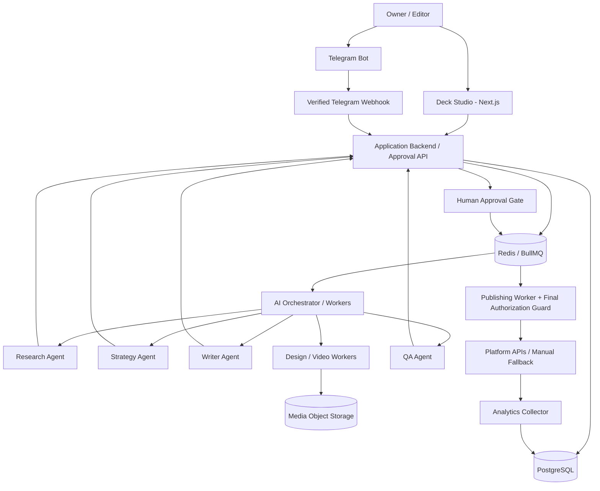

# Social Media Bot Army — Deck Studio Master Blueprint

**Document type:** Project summary, technical blueprint, and Codex development handoff  
**Version:** 1.0  
**Prepared:** 12 October 2026  
**Project:** Social Media Automation / AI Content Factory  
**Primary development tool:** OpenAI Codex  
**Alternative AI provider:** Claude  
**Example content brand:** Daddy Choize  
**Timezone:** Asia/Bangkok (ICT, UTC+7)

---

## 1. Executive Summary

### Goal

Build an independent, self-owned **Social Media Bot Army** to research, plan, produce, review, schedule, publish, and analyze social media content. The system should be controlled through a **Deck Studio** web frontend, with **Telegram approval on mobile** and a target of **one approved post per day**. It must **not require purchasing or downloading the paid workflow/templates offered by the referenced YouTube creator**.

### Target end-to-end workflow

```text
User / Campaign Settings
         │
         ▼
Daily Scheduler / Orchestrator
         │
         ▼
Trend Research → Topic Strategy → Script & Caption
         │
         ▼
Image / Carousel / Video Production
         │
         ▼
QA Checks + Content Version Freeze
         │
         ▼
Deck Studio Preview + Telegram Approval
         │
         ├── Reject / Request Changes → Revise → Re-review
         │
         └── Approve
                │
                ▼
          Publishing Queue
                │
                ▼
       Social Platform API / Manual Fallback
                │
                ▼
      Analytics → Feedback → Next Content Cycle
```

**Crucial division of responsibilities:** Codex is primarily the **development tool** used to build and maintain the application. The deployed automation runs via backend services/workers and AI APIs, not by keeping an interactive Codex session or personal computer open.

### Project status at the time of this summary

- **Architecture and technical specifications:** Proposed and documented in this conversation.
- **Deck Studio frontend:** An **interactive chat-embedded prototype** was shown (using local/demo data). It is not yet a deployed web application.
- **Telegram approval system:** Detailed technical design was drafted; no real Telegram Bot connection, database deployment, or verified end-to-end approval was demonstrated.
- **Daily scheduler/publisher:** Proposed workflow and configurable mock settings were shown; no recurring production service or social accounts were connected in the conversation.
- **YouTube source:** The video could not be fully viewed or transcribed. The design is **our proposed equivalent**, not a verified feature-for-feature reproduction.

---

## 2. Reference & Design Scope

**YouTube reference:** https://youtu.be/j_-GWaFW4_4?si=Y_AV6ixt3a_qCXZE  
**Video ID:** `j_-GWaFW4_4`

The request was to study a creator's AI bot army/content automation system and build similar **capabilities independently** to avoid the expense of downloading the owner's paid package.

**Verification caveat:** We were unable to retrieve the video transcript/content in the earlier discussion. Therefore specific claims about the creator's actual UI, named features, implementation, pricing, or proprietary workflows **have not been validated**. Avoid claiming the design exactly matches that video until its transcript or screenshots are reviewed.

### In scope

- Self-hosted/customizable application owned by the user.
- Multi-agent research, strategy, writing, creative production, QA, publishing and analytics.
- Deck Studio for content operations and approval management.
- Approval from Telegram and from the web application.
- Automated **one post per day** (scalable to more) following human approval.
- Multi-platform architecture: TikTok, Facebook Page, Instagram, YouTube Shorts, subject to API eligibility.
- Codex-first development and GitHub source control.
- Low-cost/open-source components where feasible.

### Out of scope for the first MVP

- Reproducing another creator's proprietary/source workflow without access.
- Bypassing platform/API restrictions.
- Guaranteed automated public posting to every platform before permissions are approved.
- Training or deploying 12 separate AI models.
- Fully autonomous, unapproved public posting as the initial safety policy.

---

## 3. System Architecture



### Recommended technical stack

| Layer | Recommended technology | Purpose |
|---|---|---|
| Development | OpenAI Codex + GitHub | Create and maintain the codebase |
| Frontend | Next.js + TypeScript | Deck Studio responsive web app |
| Backend | Next.js route handlers or separate Node/TypeScript service | Domain logic and APIs |
| Data validation | Zod | Validate inputs and webhook payloads |
| Database | PostgreSQL + Prisma | Content, versions, approvals, analytics, audit |
| Background queue | Redis + BullMQ | Durable scheduled jobs, retry and workers |
| Workflow engine (optional MVP) | n8n | Visual scheduling/integration; can be removed later |
| Agent runtime | OpenAI API / Agents SDK, optionally Claude API | Reasoning, writing, tool use |
| Media storage | S3-compatible object storage | Images, videos, thumbnails, assets |
| Video rendering | FFmpeg / Remotion or another renderer | Assemble short-form video and subtitles |
| Alerts and approvals | Telegram Bot API | Mobile notifications and approval buttons |
| Hosting | Always-on/cloud container deployment | Run scheduler, API, and workers without local PC |
| Observability | Structured logs, health checks, errors, job monitoring | Diagnose failures |

**Deployment note:** Separate frontend, API/webhook, and background workers as needed. Keep secrets in environment variables/secret management, not in Git.

---

## 4. Bot Army Roles

The full design included **12 logical agent roles**. They are **roles/prompts with tools and output schemas**, not necessarily 12 separately billed models or servers.

| # | Bot | Input | Output / Responsibility |
|---|---|---|---|
| 01 | Commander / Orchestrator | Campaign objectives, schedule | Allocate tasks; monitor runs; retries and exceptions |
| 02 | Trend Scout | Topics, platform, audience | Candidate trending topics with sources |
| 03 | Researcher | Selected topic | Evidence-based research brief and links |
| 04 | Strategist | Audience, research, brand | Angle, hook, CTA, content format, platform strategy |
| 05 | Scriptwriter | Strategy brief | Thai/English script, captions, hashtags |
| 06 | Visual Designer | Script, brand kit | Static image, carousel, thumbnail, storyboard assets |
| 07 | Video Producer | Script, media, audio | Short-form MP4, voiceover, subtitle and thumbnail |
| 08 | Quality Inspector | Content draft + sources | Factual, brand, media and compliance checks |
| 09 | Approval Manager | Frozen version | Telegram/Deck approval requests and revisions |
| 10 | Publisher | Approved immutable version | Queue, upload, schedule, record published URL |
| 11 | Analyst | Performance data | Views, engagement, clicks, conversions where available |
| 12 | Optimizer | Analytics and content history | Recommendations for subsequent campaigns |

### Recommended MVP subset

Start with ~5–6 practical services/roles rather than all 12:

1. Research + Strategy Agent
2. Writer Agent
3. Creative Producer (image/carousel first, video second)
4. QA Agent
5. Approval Service (deterministic authorization, not AI approval)
6. Publisher + Scheduler

Add advanced analytics and adaptive optimization after the core workflow is reliable.

### Agent operating standards

- Each bot has a clearly defined **input/output schema**, permitted tools and maximum budget.
- Keep sources attached to factual claims.
- Use structured outputs rather than relying on unvalidated freeform text.
- Use retries with limits, timeouts and dead-letter handling.
- The QA Agent can flag problems, but **cannot approve its own content for public publication**.
- Record the model, prompt version, cost and job status for every generation.

---

## 5. Deck Studio — Frontend Feature Specification

The proposed **Bot Army Studio / Deck Studio** is the central operations interface.

### Main navigation

| Page | Core features |
|---|---|
| Command Center | KPI cards, job status, pending approvals, failures, recent activity |
| Deck Studio | Content Kanban, card editor, previews, scripts, media and versions |
| AI Bot Army | Bot list, configuration, enable/disable, model, prompt, schedule, tests |
| Approval Center | Review queue, approve/reject/revise, history, comments |
| Content Calendar | Daily/weekly/monthly schedule, rescheduling, buffer coverage |
| Publishing Hub | Account connection, publish jobs, retries, statuses, post URLs |
| Trend Intelligence | Research suggestions, score, source, editorial selection |
| Analytics | Reach, engagement, clicks, conversions when supported, cost/ROI |
| Automation Settings | Frequency, time, format, platforms, topics, approval policy |
| Brand / Campaign Settings | Brand voice, audience, templates, branding and exclusions |

### Content Deck structure

One **Campaign** contains multiple **Content Cards**. A Content Card can produce one post or platform-specific variants.

**Each card includes:**

- Brief: objective, target audience, topic, campaign/brand.
- Script and CTA: hook, main content, narration, call to action.
- Caption / hashtags: per-platform variants and language.
- Media: image, carousel slides, video, voice/audio, captions/subtitles.
- Technical format: 9:16, 1:1, 4:5, resolution, platform restrictions.
- Source/evidence links and QA status.
- Approval state, reviewer, decisions and comments.
- Version history: compare/revert V1/V2/V3; approved snapshot remains immutable.
- Publishing targets and schedule.
- Post-publish link and analytics.

### Editor capabilities

- Preview content before publishing.
- Edit text and media references.
- Request AI regenerate **only the selected portion** (e.g., hook, slide 3, thumbnail).
- Create carousel and image assets from templates.
- Later: richer drag-and-drop slide editor and timeline/storyboard video editor.

### Frontend prototype already discussed

An interactive inline frontend mockup was previously shown with:

- Overview/dashboard cards.
- Draft / Review / Scheduled Kanban columns.
- Content editor modal (title, platform, caption).
- Simulated Approve / Reject / Send for Review.
- Agent configuration toggle demo.
- October 2026 calendar mockup.
- Simulated engagement analytics.

**Important:** Its content/state are local demo values. It is **not** connected to a real database, Telegram, Codex, publishers, accounts or analytics. The initial frontend demo contained 9 bot cards, whereas the full architecture specifies 12 roles.

---

## 6. Telegram Approval — Detailed Security Design

### User experience

Once content passes QA and the system freezes an immutable version:

1. Deck Studio creates an approval request.
2. Approval service sends a preview to a registered Telegram private chat.
3. Telegram message includes **Approve**, **Reject** and **Request Changes** inline buttons.
4. Telegram callback is delivered to the backend via a verified webhook.
5. Backend authenticates the linked user and authorizes the action.
6. An atomic database transaction records the decision and audit event.
7. If approval policy is satisfied, an outbox event schedules eligible publishing work.
8. Deck Studio and the Telegram message are updated with the final result.

### Telegram approval message fields

```text
CONTENT APPROVAL REQUIRED
Campaign: Daddy Choize
Platform: TikTok / Facebook
Content ID: CNT-2026-0042
Version: v3
Title: 5 things to prepare before your baby arrives
Media: Full preview / secure Deck Studio link
Caption: [truncated preview]
Schedule: 14 Oct 2026, 19:00 ICT
Approval expires: 13 Oct 2026, 22:00 ICT

[ APPROVE ]
[ REJECT ] [ REQUEST CHANGES ]
[ OPEN EDITOR ]
```

### Security controls (P0)

| Area | Required behavior |
|---|---|
| Webhook authenticity | HTTPS + validate `X-Telegram-Bot-Api-Secret-Token` |
| Identity | Use `callback_query.from.id`, mapped to verified internal account |
| Authorization | Active user + campaign/brand/channel-scoped RBAC |
| Delivery restriction | Prefer bound private chat for MVP |
| Callback token | CSPRNG random, opaque token; store only secure hash |
| One-time action | Token expires, consumed atomically, siblings invalidated as policy dictates |
| Replay/deduplication | Unique Telegram `update_id`, transaction guards, token consumption |
| Version binding | Approve exactly the reviewed frozen content/version, not campaign in general |
| Integrity | Snapshot and asset-manifest hashes must match |
| Transactionality | State transition + decision + audit + outbox in one DB transaction |
| Separation of duties | AI cannot approve; optional no-self-approval / 2-person policy |
| Credential protection | No raw tokens, bot secrets or platform credentials in logs/repos |
| High risk | Optional step-up authentication via signed-in Deck Studio |
| Publishing | Telegram callback never directly calls a social posting API |

### Callback design

Telegram inline-keyboard `callback_data` is byte-limited, so use a short **opaque per-action token** rather than embedding full authorization details:

```text
v1:a:<random-opaque-token>   # Approve
v1:r:<random-opaque-token>   # Reject
v1:e:<random-opaque-token>   # Request changes
```

Generate a secure random token, persist only its hash, and link its database record to the request, actor, action, expected content version, expiration, and Telegram message.

**A valid token is not sufficient authorization.** Verify the actual Telegram actor and current internal permissions at click time.

### Correct webhook flow

```text
Telegram Update
  → HTTP method / body checks
  → constant-time secret header comparison
  → schema validation
  → durable update inbox (unique update_id)
  → respond 200 only after accepted update is persisted
  → worker processes callback
  → verify actor, token, version, policy
  → DB transaction / audit / outbox
  → answerCallbackQuery + update message
```

If the backend cannot persist the update, do not return a false-success response. Reply promptly to callback queries, but never claim "Approved" before the transaction commits.

### Approval state machine

```text
DRAFT
  └─ submit → PENDING_APPROVAL
                 ├─ approve → APPROVED → SCHEDULED → PUBLISHED
                 ├─ reject → REJECTED
                 ├─ revise → REVISION_REQUIRED → NEW_VERSION → PENDING_APPROVAL
                 ├─ timeout → EXPIRED
                 ├─ content changed → SUPERSEDED
                 └─ cancel → CANCELLED
```

Additional rule: approval can be revoked before publication; an edit to any approved publishing-critical field requires fresh approval. For 2-of-3 or multi-person approval, an individual approval may be recorded without the request immediately becoming fully **APPROVED**.

### Main database entities

| Table | Main content |
|---|---|
| `users` | Internal accounts, role and status |
| `telegram_identities` | Verified Telegram user and private chat mapping |
| `content_versions` | Immutable content + media snapshot hashes |
| `approval_requests` | Version, status, expiration, approval policy |
| `approval_recipients` | Permitted approvers and recipient status |
| `approval_tokens` | Hashed per-action tokens, expiry, consumed timestamp |
| `approval_decisions` | Actor, action, request, timestamp and reason |
| `telegram_messages` | Approval request to chat/message mapping |
| `telegram_updates` | Durable webhook inbox + deduplication |
| `audit_events` | Append-only traceability |
| `outbox_events` | Reliable transactional event publishing |
| `publishing_jobs` | Approved-target scheduling and idempotency key |

### API endpoints proposed

```http
POST /api/approvals
GET  /api/approvals/:id
POST /api/approvals/:id/cancel
GET  /api/approvals/:id/history
POST /api/webhooks/telegram
POST /api/telegram/link/start
POST /api/approvals/:id/step-up
```

### Telegram edge cases to implement

- Unauthorized or unlinked Telegram user.
- Linked user with revoked campaign permissions.
- Duplicate Telegram updates or double-clicked buttons.
- Expired token, superseded content version, changed approval policy.
- Approve and Reject arriving concurrently.
- Telegram message deleted or callback sent from unexpected message/chat.
- Database outage or worker restart during processing.
- Reject/Revise requiring a reason; open secured Deck Studio page or validated Mini App where needed.
- Re-send/notification retry without creating a duplicate approval request.

### Approval-focused definition of done

- All critical security cases pass automated tests.
- No duplicate approval decisions from replay/double clicks.
- Unauthorized users cannot approve across accounts, brands or campaigns.
- No publishing possible without an unchanged, valid approved version.
- Every decision has an audit record.
- End-to-end tests use a mock social publisher before enabling real credentials.

### Relevant official technical references

- Telegram Bot API: https://core.telegram.org/bots/api
- Telegram Web Apps / Mini Apps: https://core.telegram.org/bots/webapps

---

## 7. Daily Social Media Automation — One Post Every Day

**Question answered:** Can the system create and publish one post each day? **Yes**, provided generation and review succeed, a human approves the post, and the platform/account supports the desired publishing method.

### Example daily schedule (ICT)

| Time | Stage | Responsible service | Result |
|---|---|---|---|
| 06:00 | Trigger daily production | Scheduler | Start workflow |
| 06:05 | Research and content strategy | Research/Strategy | Select topic and angle |
| 06:20 | Script and production | Writer/Creative | Caption, images, carousel or video |
| 07:00 | QA and version freeze | QA/Approval Service | Validated immutable draft |
| 07:15 | Notify for approval | Telegram Bot | Preview + buttons |
| 19:00 | Post if approved | Publishing Worker | Scheduled/live post |
| Following day | Review performance | Analytics Agent | Feedback report |

**This is an example, not a schedule already activated.**

### Example automation configuration

```yaml
campaign: Daddy Choize
timezone: Asia/Bangkok
automation_enabled: true
frequency: daily
posts_per_day: 1
publish_time: "19:00"
content_topics:
  - Parenting
  - Baby products
  - AI productivity
format: mixed            # image, carousel, video, or model-selected
platform: TikTok         # example only; final choice pending
approval_mode: telegram  # human approval required
content_buffer_days: 7
unapproved_post_policy: do_not_publish
```

### Operating logic

```text
Daily scheduler
   |
   +-- Check 7-day queue for a ready content slot
   |
   +-- If queue below target: produce candidate content
   |
   +-- Run QA
   |
   +-- Send to Telegram/Deck for approval
   |
   +-- On approval: allocate an eligible publishing slot
   |
   +-- At publish time: re-check approval and payload hash
   |
   +-- Publish once or use manual fallback
   |
   +-- Log status, platform ID/link, errors and analytics
```

### 7-day content buffer recommendation

Prepare and approve posts ahead of their publishing dates. This reduces risk if AI generation fails, a reviewer is busy, or an external API is unavailable.

Example: 4 approved, 2 pending review, 1 draft.

**Fallback rule:** If today's content is not approved, use a suitable previously approved backup if allowed. If no approved content is available, send a Telegram alert and **skip publishing rather than posting unapproved material**.

### Content formatting options considered

- **A: Image + caption / carousel:** Faster and usually lower-cost starting point.
- **B: Short video + AI voice + subtitles:** More involved media/rendering pipeline.
- **C: Mixed formats selected by AI:** Most flexible, but adds QA, media and pricing complexity.

No final format was chosen in the conversation. Suggested launch order: **image/carousel first**, then short-form video; alternatively choose a single format/platform for the MVP.

### Three automation implementation approaches

| Approach | Strength | Trade-off |
|---|---|---|
| n8n | Quick visual workflows and scheduling | Another runtime/service; can become complex |
| Custom Codex-built backend | Maximum control, unified code, scalable architecture | More initial development work |
| **Hybrid (recommended initial MVP)** | Deck Studio + custom business logic, n8n as scheduler/glue | Maintain integration boundary, migrate later if desired |

**Long-term design preference:** Custom Next.js/PostgreSQL/Redis services as the source of truth; n8n may initiate workflows, but must not bypass approval checks or hold privileged publishing logic.

---

## 8. Publishing Strategy and Platform Constraints

Publishing is not equivalent to content generation. Platform APIs, account status, access scope, rate limits and audits affect automation.

| Platform | Target content | Required design consideration |
|---|---|---|
| TikTok | Short-form video | Official posting capability and relevant approval/audit may be required for public posting |
| Facebook Page | Images, video, page posts | Meta app permissions and eligible Page access |
| Instagram | Professional-account media | Eligible account and Meta content-publishing permissions/limitations |
| YouTube Shorts | Short-form video | YouTube upload API, OAuth, possible audit/visibility restrictions |

**Never** promise that every account can automatically publish on every platform without completing the official integration prerequisites.

### Publisher requirements

- Use official permitted APIs (or explicit manual publishing fallback).
- A publishing job references a specific **approved immutable version**.
- Validate account, content/media hash, approval, policy, channel and schedule immediately before publishing.
- Use idempotency keys, DB constraints, locks and reconciliation.
- Handle "publish succeeded but response was lost" without blindly posting again.
- Record remote post IDs, URLs, errors, retries and timestamps.
- Do not change an approved caption/media/platform target without re-approval.

---

## 9. Data Model — Recommended Additional Entities

Beyond approval tables, create:

```text
workspaces
brands
campaigns
brand_guidelines
content_items
content_versions
content_assets
source_references
platform_variants
agent_definitions
agent_runs
generation_jobs
qa_reports
approval_policies
approval_requests
approval_recipients
approval_tokens
approval_decisions
telegram_identities
telegram_messages
telegram_updates
publishing_accounts
publishing_jobs
published_posts
analytics_snapshots
audit_events
outbox_events
automation_schedules
```

### Core invariants

1. Content edits create a **new version** once a version has been submitted for approval.
2. A published item must be traceable to a particular approved version.
3. A Telegram callback cannot publish content directly.
4. One durable unique scheduling/publishing identity exists for each target.
5. Internal authorization is authoritative over Telegram usernames or frontend state.
6. Failures must be visible in Deck Studio and alertable via Telegram.

---

## 10. Suggested Repository Architecture

```text
social-media-bot-army/
├── apps/
│   ├── web/                       # Next.js Deck Studio UI
│   └── worker/                    # Background BullMQ consumers
├── packages/
│   ├── database/                  # Prisma schema + migrations
│   ├── domain/                    # Campaign, content, approval, publishing rules
│   ├── agents/                    # Agent roles, prompts, tools, schemas
│   ├── telegram/                  # Webhook / messaging / callback handling
│   ├── publishers/                # Social platform adapters + mock adapter
│   ├── media/                     # Image/video rendering interfaces
│   ├── shared/                    # Types, validation, configuration
│   └── ui/                        # Shared design components
├── infra/
│   ├── docker-compose.yml
│   └── deployment/
├── docs/
│   ├── architecture.md
│   ├── approvals-security.md
│   ├── data-model.md
│   ├── workflows.md
│   └── deployment.md
├── tests/
│   ├── integration/
│   ├── security/
│   └── e2e/
├── .env.example
├── README.md
└── package.json
```

This is a **proposed** layout; Codex should inspect the repository first and adapt rather than overwrite existing code.

### Example environment configuration

```dotenv
# Telegram
TELEGRAM_BOT_TOKEN=
TELEGRAM_WEBHOOK_SECRET=

# Application
APP_BASE_URL=
DATABASE_URL=
REDIS_URL=

# AI providers
OPENAI_API_KEY=
ANTHROPIC_API_KEY=

# Security / storage
APP_ENCRYPTION_KEY=
TOKEN_HASH_PEPPER=
MEDIA_STORAGE_BUCKET=

# Approval / publishing
APPROVAL_TTL_HOURS=24
APPROVAL_REQUIRE_PRIVATE_CHAT=true
PUBLISHING_REQUIRE_VALID_APPROVAL=true
DEFAULT_TIMEZONE=Asia/Bangkok
```

Never commit actual secret values.

---

## 11. Phased Implementation Roadmap

| Phase | Deliverables | Exit criteria |
|---|---|---|
| **0. Define scope** | Choose 1 brand, 1 platform, 1 format; brand kit; posting policy | MVP criteria locked |
| **1. Deck Studio foundation** | Auth, campaign/content models, cards/board, preview, editing, Postgres | Data persisted and visible in UI |
| **2. Bot pipeline** | Scheduler, orchestrator, research/writer/creative/QA, job status | Produces valid draft with sources and assets |
| **3. Telegram approval** | Verified webhook, enrollment, tokenized actions, audit, version freeze | Security and callback tests pass |
| **4. Calendar + 7-day buffer** | Automation settings, queue, reschedule, missed-post alert | Seven slots manageable; no unapproved publishing |
| **5. Publishing integration** | Mock publisher, then first real platform official API | One approved post publishes and is logged correctly |
| **6. Video and cross-posting** | Voice/subtitles/video, platform variants, more accounts | End-to-end multi-format QA |
| **7. Analytics / optimizer** | Performance collection, cost monitoring, strategy feedback | Real metrics visible and used responsibly |
| **8. Production hardening** | Observability, backups, alerting, secret rotation, security testing | Stable operations and rollback process |

### MVP success criteria

- Generate at least 1 content candidate per day.
- Save all results in Deck Studio with traceable versions.
- Notify the right approver in Telegram.
- Approve/reject/revise securely without duplicate decisions.
- Publish **only** approved matching versions on an eligible channel.
- Handle failed approval, generation and publishing without silent data loss.
- Maintain a configurable queue/buffer and visible status history.

### Cost strategy

- Use Codex for engineering, not as the continuously running scheduler.
- Reuse foundation-model APIs across agent roles; use lower-cost models for simple transformations.
- Cache research and reuse approved media/templates where licensing permits.
- Prefer images/carousels initially to control media costs.
- Limit retries, token budgets and unnecessary regeneration.
- Track actual AI tokens, renders, storage, hosting and external integration costs per post.
- Self-hosting avoids buying the creator's workflow but **does not mean zero cost**. APIs, hosting, media generation and platform integration may incur charges.

---

## 12. Items Still Requiring Decisions

| Decision | Example/Recommendation | Status |
|---|---|---|
| Brand | Daddy Choize | Proposed/example |
| First platform | TikTok, Facebook Page, Instagram or YouTube | **Not finalized** |
| Initial format | Image/carousel for cheaper MVP; video next | **Not finalized** |
| Target frequency | 1 post/day | **Requested** |
| Posting time | 19:00 ICT | Example, **not finalized** |
| Approval channel | Telegram (Deck Studio also available) | Requested |
| Human approval | Mandatory for MVP | Recommended |
| Content buffer | 7 days | Recommended |
| Scheduling engine | Hybrid n8n + custom service, or custom BullMQ | Recommendation |
| AI provider | OpenAI API primarily; Claude optional | Preferred direction |
| Hosting | Cloud/container/VPS | Not selected |
| Video comparison to YouTube reference | Verify clip/screenshots/transcript | **Unverified** |
| Budget ceiling | Determine API, rendering, hosting spend | Not supplied |

---

## 13. Codex Master Build Prompt

Copy the following prompt into Codex when starting the repository implementation:

> You are a senior full-stack architect, AI agent engineer, and application security engineer. Build a self-owned Social Media Bot Army web application with Deck Studio as its frontend.
>
> **Primary goal:** Produce and schedule one social-media post per day, starting with one brand and one officially supported platform. All externally published content must pass an explicit human approval step via Telegram or authenticated Deck Studio.
>
> **Read** `Social_Media_Bot_Army_Deck_Studio_Master_Blueprint.md` in the repository first. Treat it as the product requirements and technical direction. Inspect the existing repository and do not overwrite existing working features.
>
> **Stack:** TypeScript, Next.js, PostgreSQL/Prisma, Redis/BullMQ, Telegram Bot API, Docker Compose, provider-agnostic AI services with OpenAI API as the default and optional Claude support.
>
> **Required modules:** Campaigns, content cards/versions, AI job orchestrator, research/writer/creative/QA agents, media storage/preview, automation settings, calendar and seven-day queue, Telegram secure approval, audit history, publishing adapter with mock mode, and job/analytics dashboard.
>
> **Approval security:** Private-chat account linking; verify webhook secret and Telegram sender identity; current scoped RBAC; opaque one-time callback tokens stored hashed; immutable content snapshots; database transaction + row lock + decision + audit + outbox; replay and duplicate protection; reject/revise; expiry; superseding; prevent any publishing if content or approval is invalid.
>
> **Daily pipeline:** Trigger production according to configurable timezone/schedule; research topic; develop strategy; generate copy/media; QA; submit frozen version for approval; put approved version into publishing queue; at configured post time re-validate approval and publish through an eligible official API. If no approved post is available, notify and skip; never bypass approval.
>
> **Development sequence:** (1) repo inspection and architecture notes, (2) database and domain logic, (3) Deck Studio frontend, (4) mocked agent/approval/publisher workflows, (5) real AI pipeline, (6) real Telegram approval, (7) first approved platform publisher, (8) automated tests, deployment docs and observability.
>
> **Engineering practices:** Strict TypeScript, schema validation, secrets via environment variables, structured logging without credentials, durable queues, idempotent jobs, retry/reconciliation, meaningful tests, migrations, `.env.example`, documented setup and secure defaults.
>
> Do not claim that a platform is integrated or that a test passed unless it was actually executed. Show what was implemented, what is mocked, and what remains blocked by API permissions. Prioritize a working, auditable MVP over building all 12 agents simultaneously.

---

## 14. Recommended Next Action

1. Choose the **first platform** and **first content format**.
2. Create a dedicated GitHub repository (or select an existing one) and commit this blueprint as `docs/MASTER_BLUEPRINT.md`.
3. Ask Codex to implement **Phase 1: Deck Studio + persisted content cards** before connecting social accounts.
4. Add a mock end-to-end flow, then implement Telegram approvals with full security tests.
5. Enable one real publishing integration only after obtaining the required official API access.
6. Launch 1 post/day with human approval and a 7-day buffer; add more agents/platforms after it is stable.

---

## 15. Summary of Our Conversation

- You provided a YouTube reference and asked to build a comparable AI bot-army pipeline without buying expensive workflows from the creator.
- You preferred **Codex** for development, with Claude as a potential alternate/secondary AI model.
- We designed a multi-role **AI Bot Army** with orchestration, research, strategy, writing, creative, quality, approval, publishing and analytics.
- You specifically requested **Deck Studio** and an approval channel similar to the referenced system.
- We proposed a Deck Studio dashboard with command center, Kanban content board, bot management, approval queue, calendar and analytics.
- We created an **interactive Deck Studio demo** in chat, explicitly using local illustrative data rather than a deployed app.
- You requested a secure **Telegram Approve button** technical specification; we described identity mapping, tokens, state machine, database, webhook security, audit, idempotency and acceptance tests.
- You asked if the whole process could automatically publish **one post every day**; we described daily scheduling, Telegram approval, a seven-day content buffer, platform-specific permissions, and n8n/custom/hybrid implementation approaches.
- The final objective is a **production-capable, low-cost, Codex-built content automation platform** that you own and can extend independently.

**This document is a consolidated design/handoff, not a claim of completed implementation.**