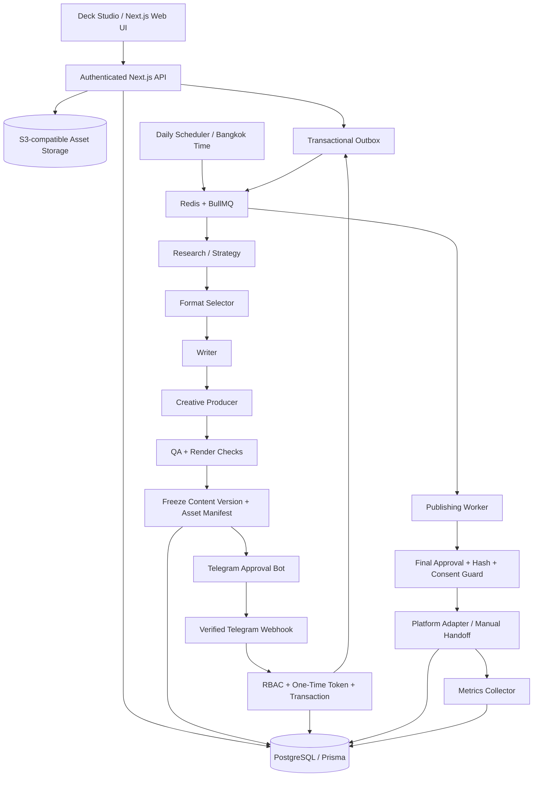
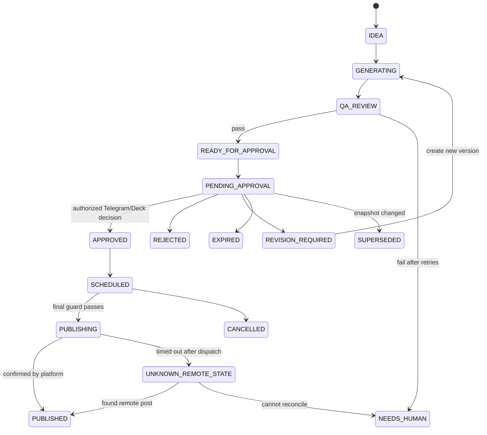
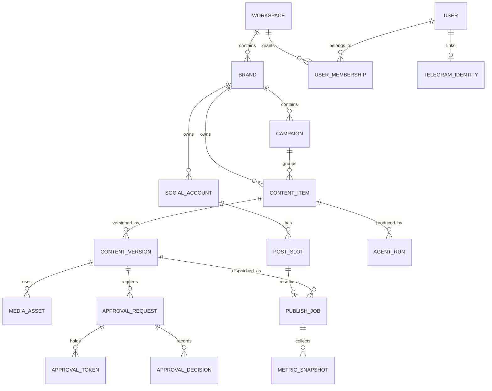

# Social Media Bot Army — Codex-first MVP Technical Specification

**Version:** 1.0 · **Date:** 2026-10-12 · **Language:** Thai-first · **Pilot brand:** Daddy Choize  
**Status:** Implementation blueprint — **NOT deployed / NOT connected to live accounts**.  
**Focus:** One approved post per day, AI chooses `IMAGE`, `CAROUSEL`, or `SHORT_VIDEO`, with Deck Studio, Telegram approval, and publishing adapters.

> **Source limitation:** The referenced YouTube video `https://youtu.be/j_-GWaFW4_4` was not fully accessible for a verified transcript/screen inspection. This is an independently designed system based on the features requested, not a verified clone of the video or the channel owner's paid files.

## 1) Executive Decision

Build a **small, opinionated production system**, not 12 independently hosted LLM agents. Start with **five executable roles** coordinated by deterministic TypeScript workflows:

1. **Research & Strategy:** identify topics and cite sources.
2. **Planner & Format Selector:** choose image / carousel / short video and create a structured content brief.
3. **Writer:** Thai hook, script, caption, hashtags, CTA, on-screen text.
4. **Creative Producer:** create assets and render variants; for video use TTS + static/animated visuals + FFmpeg, not an expensive text-to-video requirement.
5. **QA & Safety:** check claims, repetition, missing sources, asset rights, Thai captions, platform requirements, and policy.

Approval, scheduling, publishing, and analytics are **normal application services**, not LLM agents. Codex is the **developer**; API models power the production runtime. Claude can later be substituted via a provider abstraction.

### MVP baseline

| Setting | Default | Notes |
|---|---|---|
| Brand | Daddy Choize | Thai-first parenting, baby-preparation and AI productivity |
| Output cadence | **1 published post/day** | Target, not a guarantee when approval or API unavailable |
| Time zone | `Asia/Bangkok` | Store timestamps in UTC |
| Target publish | `19:00` Bangkok | Adjustable in Deck Studio |
| Production trigger | `06:00` Bangkok | Replenish forward content buffer |
| Content buffer | 7 future posting slots | Bootstrap 7 drafts; replenish 1 as content is consumed |
| Approval | Telegram + Deck Studio | Mandatory in MVP; no auto-approval |
| Platforms | Start with one verified account | Design adapters for TikTok, Instagram, Facebook Page, YouTube Shorts |
| Default publishing | Mock/sandbox until connected | Manual-publish fallback if APIs not authorized |
| Language | Thai | English UI labels acceptable |
| Max generation retries | 2 per stage | Failed job goes to attention queue |
| Budget control | Configurable spend cap | Block expensive media variants once exceeded |

## 2) Scope

### Included in MVP

- User login; one workspace and brand (schema extensible to multi-brand).
- Dashboard, Deck Board, Content Editor, Calendar, Approval Queue, Automation Settings, Bot Runs/Logs, Basic Analytics, Integrations and Costs.
- Deterministic pipeline + agent calls with JSON schema outputs and traceable references.
- Image post, 3–5-slide carousel, 15–45-second vertical video assembled from templated scenes, stills, transitions, audio/TTS, burned subtitles.
- Preview of content and *exact* frozen publish snapshot.
- Secure Telegram `/start` account-link enrollment, notification, Approve / Reject / Request Revision.
- Daily scheduled content buffer, reminders, approved-only queue and publish/manual handoff.
- Mock social provider and at least one real provider integration **only when authorized**.
- Status, failed-job retry, idempotency, audit history, and cost per generation run.

### Deferred beyond MVP

- AI-generated cinematic text-to-video; real-time trend scraping from closed platforms; AI auto-commenting/DM mass campaigns; auto-affiliate scraping; cross-brand multi-tenant billing; advanced attribution, A/B optimizer, drag-and-drop nonlinear video editor; many-platform simultaneous release; autonomous public posting without approval.

## 3) System Architecture



**Trust boundaries:** Telegram can request approval but cannot publish. A job in BullMQ is not evidence of authorization. Every publishing attempt must re-validate a current approval for the immutable snapshot and account scope.

### Recommended technical stack

| Layer | Choice | Why |
|---|---|---|
| Dev experience | **Codex + GitHub** | Generate/test/refactor code, migrations, CI, UI |
| Frontend | Next.js App Router, TypeScript, Tailwind, shadcn/ui | Fast dashboard and editor |
| Backend | Next.js Route Handlers + separate Node worker process | Shared types, independent worker lifetime |
| Database | PostgreSQL 16+, Prisma | Durable state, migrations and transactions |
| Queue | Redis + BullMQ | Delayed/retry/repeatable jobs with worker isolation |
| AI runtime | OpenAI Responses API / Agents SDK, Zod structured outputs | Reliable agent tasks; adapters can support Claude |
| Media | SVG/HTML slide templates rendered via Playwright; Sharp; FFmpeg; TTS provider | Predictable, low-cost MVP video/carousel output |
| File storage | S3-compatible private bucket + signed URLs | Asset previews, originals, exported files |
| Telegram | Telegram Bot API webhook | Approvals via private chat |
| Auth | Auth.js with credential/OAuth setup appropriate for owner | Deck Studio sessions and user roles |
| Hosting | Docker Compose on VPS or hosted web + dedicated worker | Background jobs must not depend on browser or serverless request lifetime |
| Observability | Structured logs, error events, job timeline and cost ledger | Debug failure and spending |

**Deployment minimum:** `web`, `worker`, `postgres`, `redis`, object storage, TLS reverse proxy. Keep `worker` long-running. Maintain backup and restore tests.

## 4) Daily Workflow and Scheduling

### Initial bootstrap

- Create 7 future local-date slots with `targetDate` and `19:00 Asia/Bangkok`.
- Generate up to 7 drafts **with staggered queue/concurrency limits**, not in one LLM request.
- Send digest/approval requests; as content gets approved, attach it to a unique future posting slot.
- Display queue coverage: `Approved 4 / Pending 2 / Draft 1`.

### Steady-state every day

| Time ICT | Trigger | Action | Failure behavior |
|---|---|---|---|
| 06:00 | Cron | Check next 7 days; create only missing slot(s); queue generation | Retry; flag failed |
| 06:05–07:00 | Worker | Research → format decision → script → render → QA | Retry <=2; escalate |
| 07:15 | Ready event | Freeze version, create approval request, notify Telegram | Retry notification without new request |
| 16:00 | Cron | Remind if next post not approved | Telegram alert + dashboard badge |
| 18:45 | Cron | Preflight check scheduled approval/account/media | Warn / mark blocked |
| 19:00 | Scheduler | Publish exactly one eligible, approved post | Reconcile unknown result; no blind duplicate retry |
| Next day | Metrics sync | Query provider-supported metrics; calculate KPI | Mark `METRICS_PENDING` if unavailable |

**Posting guard:** If no approved post for the slot, optionally choose a compatible, unused, previously approved reserve item **only if its approval explicitly covers this account/caption/media/platform**. Otherwise mark `MISSED` and alert; never auto-approve.

**Time handling:** `target_local_date` + `timezone` are business fields; `publish_at_utc` is computed at schedule creation. Daily scheduler uses timezone-aware calendar date, not naive `+24h` math.

### State machine



## 5) How AI Chooses Image vs Carousel vs Video

AI does **not** choose by whim. Use scored candidates and deterministic constraints.

1. Researcher proposes 3–5 topics, with `sources[]`, freshness, engagement intent and claim-risk scores.
2. Deduplicate against 30–60 days of published/scheduled topics (topic fingerprints + vector similarity optional).
3. Strategy role emits **structured three-format options**, each with estimated asset cost, suitability, required evidence and production complexity.
4. Deterministic validator excludes formats that cannot be generated within current budget/time, unsupported platform specs, or licensing/policy constraints.
5. Rank remaining proposals by weighted score. AI returns rationale, but final format selected by validation/scoring code.

**Example score** (illustrative, tune after collecting performance): audience fit 30%, educational suitability 20%, expected engagement 20%, novelty 15%, production efficiency 15%, minus risk penalty.

| Format | Good when | MVP production |
|---|---|---|
| IMAGE | One insight, checklist summary, product highlight | 1080x1350 template, caption |
| CAROUSEL | Step-by-step, comparisons, 3–5 tips | 3–5 consistent slide templates + caption |
| SHORT_VIDEO | Storytelling, hook + demonstrations, quick tutorial | 9:16 scenes, stills, text animation, Thai TTS, subtitles, FFmpeg export |

**Video fallback:** If TTS or render fails, do **not silently switch an approved video into an image**. Regenerate a new draft/version, complete QA and request a fresh approval.

**Content safety:** Parenting, infant health, product recommendations and claims require citations and manual review for high-impact statements. No unsupported medical claims or fabricated product experiences. Record image/video usage rights and affiliate disclosure where applicable.

### Structured content-brief example

```json
{
  "topic": "Checklist เตรียมของใช้เด็กแรกเกิด",
  "audience": "พ่อแม่มือใหม่ในประเทศไทย",
  "objective": "educate",
  "format": "CAROUSEL",
  "formatRationale": "หัวข้อนี้มี 5 ขั้นตอน จึงอ่านง่ายเป็นสไลด์",
  "hook": "ก่อนลูกคลอด เตรียม 5 อย่างนี้แล้วหรือยัง?",
  "slides": [
    { "order": 1, "headline": "เตรียมรับสมาชิกใหม่", "body": "เช็กลิสต์ของใช้จำเป็น" }
  ],
  "caption": "เช็กลิสต์สำหรับคุณพ่อคุณแม่มือใหม่...",
  "hashtags": ["#DaddyChoize", "#คุณพ่อมือใหม่"],
  "sourceUrls": [],
  "claimRisk": "LOW",
  "proposedPublishAt": "2026-10-14T19:00:00+07:00"
}
```

The schema is a **contract example**; production validation should ensure complete slide count, text limits, legally usable assets, and supported media encoding.

## 6) Deck Studio Frontend — Screen-by-Screen

### Sidebar

`Overview | Content Deck | AI Bot Runs | Approval Center | Content Calendar | Automation Settings | Integrations | Analytics | Costs & Logs`

| Page | Primary widgets/actions | MVP behavior |
|---|---|---|
| Overview | Today's Post, 7-Day Coverage, Pending Approval, Failed Runs, Cost MTD | Live DB queries, not placeholder stats |
| Content Deck | Kanban `Draft / QA / Review / Approved / Scheduled / Published` | Cards with filter, open editor, version diff |
| Editor | Preview image/slide/video, caption, hashtag, sources, media metadata | Edits create new version; frozen approvals cannot be silently edited |
| Approval Center | Queue, reviewer, expiry, approve/reject/revise, history | Same backend authorization as Telegram |
| Content Calendar | Local calendar, one target slot per day | Reschedule only through approved snapshot/guard rules |
| Automation Settings | active toggle, one/day, 19:00, content themes, format policy, budget | Validate and save settings; dry-run button |
| AI Bot Runs | Runs, step duration, error, retry, token/media cost | Inspect every step/output/ref |
| Integrations | Telegram link, Social OAuth, capability status | Honest labels: connected, needs consent, manual only |
| Analytics | Views, reach, engagement, post URL, cost/post | Provider-dependent supported metrics only |

**Deck content card:** thumbnail; topic; format; account; scheduled time; owner; latest content version; status; QA score; approval due; asset link; short actions.

### First-run wizard

1. Create Brand + brand tone + forbidden claims.
2. Choose 1 platform account or `Mock Publisher`.
3. Connect Telegram approver.
4. Configure 1/day, 19:00 ICT, max monthly cost.
5. Trigger `Generate First Post`.
6. Preview and approve from Telegram.
7. Test sandbox publishing; turn on real publishing **only after explicit connection and smoke test**.

## 7) Telegram Approval — Security Contract

### Buttons

`✅ Approve | ❌ Reject | ✏️ Request Changes | 🔎 Open Preview`

- Use Telegram **private chat**; link `callback_query.from.id` to an active internal user.
- Authenticated Deck Studio users initiate Telegram enrollment via expiring one-time pairing code.
- Callback uses `v1:a:<random-token>` etc; callback payload max 64 bytes. Store **SHA-256 token hash**, not token.
- Token binds to request/version/reviewer/action/message, expires (default 24h), single-use.
- `X-Telegram-Bot-Api-Secret-Token` verified using constant-time comparison and HTTPS.
- Deduplicate Telegram `update_id` with durable inbox; respond using `answerCallbackQuery`.
- DB transaction uses `SELECT ... FOR UPDATE` or equivalent guarded update.
- Verify active user, brand/account permission, content hash, approval status, request expiry, recipient, and one-time token.
- If user hits Reject/Revise, collect reason via authenticated Deck Studio/TG Mini App; safely reject missing required reason.
- Commit `approval_decision`, consume/invalidate tokens, write `audit_event` and `outbox_event` atomically.
- After decision, update Telegram message to show **server-confirmed** status, do not rely on the button disappearing as authoritative evidence.
- Publishing service checks approval **again** immediately before dispatch.

### Approval rule

For MVP: **one authorized owner** can approve. Schema should be able to expand to multi-approver policy. Approval applies to frozen `snapshot_hash` containing caption, hashtags, media hashes, selected account and platform-specific publishing options. Relevant edits create a new version and supersede previous approval.

### Acceptance tests

Unauthenticated callback → denied; wrong Telegram user → denied; revoked permission → denied; expired token → denied; replay/double-click → one decision; two conflicting decisions → one valid state; old content version → denied; modified asset → blocked; webhook replay → processed once; no approval → no publish; failed DB commit → no partial state; non-explicit social consent → no publish.

## 8) Database Design — PostgreSQL + Prisma

### Entity relationship model



### Tables & important columns

| Table | Fields (representative) | Constraints/indexes |
|---|---|---|
| `users` | `id`, `email`, `status`, `created_at` | unique email |
| `workspaces` | `id`, `name` | PK |
| `user_memberships` | `user_id`, `workspace_id`, `role`, `brand_scope` | unique user+workspace; RBAC |
| `brands` | `id`, `workspace_id`, `name`, `voice_json`, `policy_json` | index workspace |
| `campaigns` | `id`, `brand_id`, `goal`, `topics_json`, `status` | index brand |
| `social_accounts` | `id`, `brand_id`, `platform`, `external_id`, `state`, `capabilities_json`, `secret_ref` | unique platform+external ID; store secrets outside app DB when feasible |
| `automation_policies` | `id`, `brand_id`, `enabled`, `posts_per_day`, `local_time`, `timezone`, `buffer_days`, `formats_json`, `budget_cap` | unique active policy per brand/channel |
| `post_slots` | `id`, `social_account_id`, `target_local_date`, `publish_at_utc`, `status`, `content_version_id` | unique social-account+date for MVP |
| `content_items` | `id`, `brand_id`, `campaign_id`, `topic`, `status`, `topic_fingerprint` | index brand+status |
| `content_versions` | `id`, `content_item_id`, `version_no`, `format`, `caption`, `script_json`, `manifest_json`, `snapshot_hash`, `created_at` | unique item+version; immutable once submitted |
| `media_assets` | `id`, `content_version_id`, `kind`, `storage_key`, `sha256`, `mime_type`, `duration_ms`, `rights_json` | asset checksum validation |
| `agent_runs` | `id`, `content_item_id`, `stage`, `model`, `status`, `inputs_hash`, `result_json`, `error`, `cost_usd` | trace + accounting |
| `source_references` | `id`, `content_item_id`, `url`, `title`, `fetched_at`, `claim_refs_json` | evidence history |
| `approval_requests` | `id`, `content_version_id`, `account_id`, `status`, `snapshot_hash`, `expires_at`, `requested_at` | index status+expiry |
| `approval_tokens` | `id`, `request_id`, `reviewer_id`, `action`, `token_hash`, `consumed_at`, `expires_at`, `message_id` | unique token hash |
| `approval_decisions` | `id`, `request_id`, `actor_id`, `decision`, `reason`, `at` | unique request+actor for one-approver MVP |
| `telegram_identities` | `user_id`, `telegram_user_id`, `chat_id`, `linked_at`, `disabled_at` | unique Telegram User ID |
| `telegram_inbox` | `update_id`, `payload_json`, `processed_at`, `status` | unique update ID |
| `telegram_messages` | `request_id`, `chat_id`, `message_id`, `sent_at` | unique chat+message |
| `publish_jobs` | `id`, `post_slot_id`, `content_version_id`, `approval_request_id`, `account_id`, `status`, `idempotency_key`, `remote_post_id`, `attempted_at` | unique idempotency key |
| `metric_snapshots` | `id`, `publish_job_id`, `collected_at`, `views`, `likes`, `comments`, `shares`, `reach`, `raw_json` | time series |
| `audit_events` | `id`, `actor_type`, `actor_id`, `entity_type`, `entity_id`, `event`, `metadata_json`, `created_at` | append-only policy |
| `outbox_events` | `id`, `event_type`, `entity_id`, `payload_json`, `published_at`, `created_at` | durable delivery |

### Core SQL constraints (representative)

```sql
CREATE UNIQUE INDEX ux_slot_account_day
  ON post_slots (social_account_id, target_local_date);
CREATE UNIQUE INDEX ux_version_number
  ON content_versions (content_item_id, version_no);
CREATE UNIQUE INDEX ux_telegram_inbox_update
  ON telegram_inbox (update_id);
CREATE UNIQUE INDEX ux_approval_token_hash
  ON approval_tokens (token_hash);
CREATE UNIQUE INDEX ux_publish_idempotency
  ON publish_jobs (idempotency_key);
```

Use database transactions to freeze the content version and create the approval request. Enforce version immutability at the service layer plus permissions/DB rules; a hash alone does not prevent edits.

### Example transition pseudo-code

```typescript
async function approveFromTelegram(input: VerifiedTelegramCallback) {
  return db.$transaction(async tx => {
    const token = await lockAndFindUnconsumedToken(tx, sha256(input.token));
    assertTokenActionAndExpiry(token, input.action);
    const actor = await findActiveLinkedUser(tx, input.telegramUserId);
    await requireApprovalScope(tx, actor.id, token.requestId);
    const request = await lockApprovalRequest(tx, token.requestId);
    assertRequestPendingAndVersionCurrent(request);
    assertSnapshotHashMatchesFrozenAssets(request);
    await insertDecision(tx, { request, actor, action: input.action });
    await consumeAllRequestTokens(tx, request.id);
    await transitionApprovalRequest(tx, request.id, input.action);
    await appendAuditEvent(tx, request, actor, input.action);
    if (input.action === "APPROVE") {
      await insertOutboxEvent(tx, "APPROVAL_GRANTED", request.id);
    }
  });
}
```

Reject/Revision require a reason and should not be committed via a single callback without a reason-entry flow. The above is illustrative pseudocode, **not ready-to-run code**.

## 9) Job Queues and Failure Recovery

| Queue | Jobs | Concurrency (starter) |
|---|---|---|
| `pipeline` | research, format, write, creative, QA | 1–2 |
| `media` | render image, render carousel, FFmpeg video | 1 |
| `notifications` | Telegram send/edit, reminders | 2 |
| `publishing` | preflight, publish, reconcile | 1 per account |
| `analytics` | metrics sync, KPI aggregation | 1–2 |

- Use deterministic `jobId` per `brandId + slotDate + pipelineVersion` to prevent duplicate generation.
- `publishIdempotencyKey = hash(accountId + contentVersionId + slotId)`.
- API request timeouts **after upload starts** can be ambiguous. Move to `UNKNOWN_REMOTE_STATE`, query remote status, and request manual investigation instead of blind retry.
- Dead-letter failed jobs with reason; expose safe `Retry` action in Deck Studio.
- Apply per-provider rate and spend limit; exponential backoff for recoverable errors, no retry for security or validation failures.
- Store trace links per stage; redact secrets and personal data.

## 10) API Contract

| Method | Route | Purpose |
|---|---|---|
| `GET/POST` | `/api/brands` | Brand settings |
| `GET/PUT` | `/api/automation-policy` | Daily scheduling policy |
| `POST` | `/api/pipeline/run` | Manual/dry-run generation, idempotent |
| `GET` | `/api/agent-runs` | Trace status |
| `GET/POST` | `/api/contents` | List/create content |
| `GET/POST` | `/api/contents/:id/versions` | View and create content version |
| `POST` | `/api/contents/:id/submit` | Freeze + QA gate + approval request |
| `GET` | `/api/approvals` | Approval queue |
| `POST` | `/api/approvals/:id/decision` | Authenticated Deck approval/rejection/revision |
| `POST` | `/api/webhooks/telegram` | Verify Telegram webhook, enqueue callback |
| `POST` | `/api/telegram/link/start` | One-time account enrollment |
| `GET` | `/api/post-slots` | 7-day schedule |
| `POST` | `/api/post-slots/:id/reschedule` | Guarded schedule change |
| `GET` | `/api/social-accounts` | Status/capability matrix |
| `GET` | `/api/analytics/summary` | Provider-backed metrics |
| `GET` | `/api/billing/usage` | Token/media/runtime costs |

API must authenticate and authorize at route *and* service layer; validate inputs with Zod; paginate list endpoints; return structured error codes.

## 11) Publishing Adapter Interface

```typescript
type Format = "IMAGE" | "CAROUSEL" | "SHORT_VIDEO";
type PublishOutcome =
  | { state: "PUBLISHED"; remotePostId: string; postUrl?: string }
  | { state: "PROCESSING"; remoteOperationId: string }
  | { state: "UNKNOWN_REMOTE_STATE"; reason: string }
  | { state: "MANUAL_REQUIRED"; reason: string };

interface SocialPublisher {
  platform: "TIKTOK" | "INSTAGRAM" | "FACEBOOK" | "YOUTUBE" | "MOCK";
  checkCapabilities(accountId: string): Promise<{
    formats: Format[];
    canDirectPublish: boolean;
    requiresUserConsent: boolean;
    missingPermissions: string[];
  }>;
  validateMedia(manifest: FrozenManifest): Promise<void>;
  publish(approved: ApprovedPublication): Promise<PublishOutcome>;
  reconcile(jobId: string): Promise<PublishOutcome>;
  metrics(remotePostId: string): Promise<Record<string, number | null>>;
}
```

Start with **MockPublisher** implementing the exact interface. Add real publishing integrations one by one, based on documented OAuth/scopes, supported media, consents, account configuration, API review and quota.

**Platform-specific current cautions:**

- **TikTok:** Content Posting API `video.publish` scope and explicit creator consent apply; unaudited apps are restricted to private visibility. Photo posting support exists but check policy/format limits. Official: <https://developers.tiktok.com/docs/en/content-posting-api-get-started> and <https://developers.tiktok.com/docs/en/content-sharing-guidelines>.
- **Instagram:** Publishing is for supported Professional accounts with the right Instagram/Meta authorization. Official guide: <https://developers.facebook.com/docs/instagram-platform/instagram-api-with-instagram-login/content-publishing/>; official Meta Postman docs: <https://www.postman.com/meta/instagram/documentation/6yqw8pt/instagram-api>.
- **Facebook:** Publish through an eligible Facebook Page and required Page permissions; not unrestricted posting to personal profiles. Verify current Graph API scope/permissions in developer console.
- **YouTube:** API upload requires OAuth authorization; unverified API projects can have public-visibility restrictions. Official: <https://developers.google.com/youtube/v3/docs/videos/insert>.

**Fallback:** If direct publish is not available, export the approved media and caption, notify the user and set slot to `MANUAL_ACTION_REQUIRED`; do not represent it as published.

## 12) Security, Compliance and QA

### Production guard checklist

- [ ] User is logged in; no anonymous mutations.
- [ ] Telegram identity bound to internal active user; approval scope checked.
- [ ] Telegram webhook secret validated and update deduped.
- [ ] Approval token short-lived, one-time, stored hashed; version hash current.
- [ ] Approved snapshot covers caption, assets, hashtags, platform/account and publishing options.
- [ ] Edits after approval require new version + approval.
- [ ] Publish slot and idempotency constraints enforced in DB.
- [ ] External API token stored encrypted/secret manager; never exposed in frontend.
- [ ] Publish only with valid account permission and required platform consent.
- [ ] Preview links are scoped/signed; avoid public S3 bucket.
- [ ] Record provenance/licensing of all images/music/video and affiliate disclaimers.
- [ ] Do not scrape platforms through prohibited methods or bypass publication restrictions.
- [ ] Enforce cost ceilings and rate limits.
- [ ] Audit log records rejected/approved/rescheduled/published outcomes.
- [ ] Backups, restore test and monitoring alerts configured.

### QA levels

- **Technical:** correct aspect ratio, PNG/JPG/MP4, target length, video audio, readable Thai text/subtitles, file size, asset availability.
- **Content:** factual accuracy/source match, no duplicated stories, no misleading health recommendations, no unsupported endorsement, correct spelling.
- **Brand:** tone, palette, logos (when owned), CTA, disclosure.
- **Publish:** target account, date/time, privacy level, caption/version hash, remote capabilities.

## 13) Repository and Service Layout

```text
bot-army-studio/
├── apps/
│   ├── web/                         # Next.js / Deck Studio
│   │   ├── app/(dashboard)/
│   │   └── app/api/
│   └── worker/                      # Node BullMQ processor / scheduler
├── packages/
│   ├── db/                          # Prisma schema, migrations, seeds
│   ├── domain/                      # Types, Zod schemas, FSM, policies
│   ├── ai/                          # Model adapters + prompt versions
│   ├── media/                       # Slides/video rendering, FFmpeg
│   ├── telegram/                    # Notifications, webhook validation
│   ├── publishers/                  # Mock + platform adapters
│   └── ui/                          # Shared UI components
├── infra/
│   ├── compose.yaml
│   └── nginx-or-caddy/
├── tests/
│   ├── integration/
│   ├── security/
│   └── e2e/
├── docs/
│   ├── ADRs/
│   └── API_AND_RUNBOOK.md
├── .env.example
├── package.json
└── README.md
```

Do not run FFmpeg inside time-limited serverless API functions; isolate media renders to the worker.

## 14) Implementation Plan — Codex Incremental Tasks

| Phase | Deliverable | Key tests | Exit criterion |
|---|---|---|---|
| **P0** Bootstrap | Monorepo, Docker, Next.js, Prisma, Redis/BullMQ, Auth, seed/demo data | Health checks; migrations | `docker compose up` works; owner can log in |
| **P1** Deck Studio | Overview, Deck, Editor, Calendar, Automation Settings | Component + API route tests | Can manage sample posts and policy |
| **P2** Daily workflow | Slot generator, queues, `MockAI` pipeline, run logs | Unique slot per day, timezone, replay | Generate 7-day mock buffer deterministically |
| **P3** Real AI + media | Research, selector, writer, renderer, TTS/FFmpeg, QA | JSON contracts, render integrity, cost cap | 1 complete image, carousel and video created |
| **P4** Secure approval | Telegram linking, preview, buttons, version freeze, audit | All authorization/replay/concurrency tests | Full approve/revise/reject flows work |
| **P5** Publishing | `MockPublisher`, guard, idempotency, scheduled job, manual export | No-publish-without-approval, double-dispatch, failure recovery | E2E mock post at scheduled time |
| **P6** Real platform | Connect **one** authorized social account | OAuth, rights/consent, status reconcile | Actual permitted test post or documented manual handoff |
| **P7** Stabilize | Metrics, cost panel, alerts, backup/runbook | 7-day soak test and restore | Daily process reliable, observed and recoverable |

**Build rule:** Codex must complete tests and report actual results at the end of **each phase**. Do not begin the next phase until P0/P1-level foundations work. Do not claim real platform integration if OAuth or API audit is incomplete.

### Work breakdown (MVP priorities)

**P0 (must):** basic deck, settings, 1/day slot, media output, Telegram approval, audited/safe publishing/mock fallback.  
**P1 (recommended):** 7-day buffer, cost dashboards, secure enrollment, re-run and revisions, metrics sync.  
**P2 (later):** intelligent content optimization, multi-channel account variants, rich video editor, user-configurable agent workflows.

## 15) Operational Metrics / Definition of Done

| Metric | MVP target |
|---|---|
| One daily publish slot | Exactly one per selected account and local date |
| Publishing without valid approval | **0** |
| Double publish in retries | **0** in test scenarios; unknown remote state requires reconciliation |
| Prepared content | Target 7 calendar days ahead |
| Accepted output formats | IMAGE, CAROUSEL and SHORT_VIDEO all validated |
| Telegram test flows | Approve, reject, revise, expired, revoked, replay and duplicate callbacks |
| End-to-end | Mock full pipeline passes at scheduled time |
| Production readiness | A real platform is enabled only after OAuth/scopes and permissions are confirmed |
| Audit | Every publish linked to frozen content hash + approval actor/time |
| Cost | Every model/media call ledgered; configurable monthly hard cap |

## 16) Costs and Realistic Trade-offs

Avoid making up a fixed per-post budget without the actual selected models and media provider rate cards. Store `cost_usd` by model call, TTS seconds, image render, storage and server; expose cost/post, cost/week and budget alerts.

Cheapest safe starting point:

1. Reuse paid AI calls only for steps requiring judgment; deterministic rules for states, approvals and publishing.
2. Template-based slides + FFmpeg scene assembly instead of full generative video for every post.
3. One draft per day + 7-day rolling buffer; render additional alternatives only on explicit request.
4. Limit video duration and resolution; process one media job at a time.
5. Start one account and one approver; add platforms after the first is stable.

**Possible residual costs:** LLM/API tokens, TTS/image services, VPS/storage, domains, and optional platform-specific requirements. Codex subscription access is not the same as runtime API billing.

## 17) Codex Master Implementation Prompt

Paste this into Codex **in the repository root**. Attach this specification or place it under `docs/MVP_TECH_SPEC.md`.

```text
You are the lead engineer, application architect, and security reviewer for a
production-oriented Social Media Bot Army application called Deck Studio.

Read docs/MVP_TECH_SPEC.md completely and treat it as the primary requirements
source. Implement in phases P0 -> P7. Do not try to implement everything in a
single unverified pass.

Initial requirements:
- Stack: Next.js, TypeScript strict, Tailwind/shadcn, PostgreSQL/Prisma,
  Redis/BullMQ, standalone Node worker, S3-compatible storage, FFmpeg,
  Telegram Bot API, Docker Compose, Vitest/Playwright.
- Pilot: Daddy Choize, Thai-first, exactly one target content post per day at
  19:00 Asia/Bangkok and rolling 7-day buffer.
- AI must choose IMAGE, CAROUSEL or SHORT_VIDEO under deterministic checks.
- Short videos must work via inexpensive templated FFmpeg/TTS render flow;
  expensive generative video is optional, not required.
- Versioned, immutable content snapshots; mandatory human approval via
  Telegram and Deck Studio before any publication.
- Secure enrollment, webhook secret, hashed one-time callback tokens,
  RBAC, idempotency, transactional outbox, audit and final publish guard.
- No real social posting until account OAuth/scopes/consent and platform
  rules are confirmed. Start with MockPublisher and manual-publish fallback.
- The UI must contain Overview, Content Deck, Editor, Approval, Calendar,
  Automation Settings, Bot Runs, Integrations, Analytics and Costs.
- Give honest status: no fake metrics, no mock data labeled real, and no
  claims of live publishing until verified.

Start now with PHASE P0 ONLY:
1) inspect the repository and existing files;
2) provide an architecture plan and file tree;
3) scaffold working app, worker, DB migrations, Redis and local Docker;
4) seed one workspace, brand and mock admin;
5) add health endpoints and robust README/.env.example;
6) run migrations and tests; report exact commands/results;
7) list next P1 work and stop after P0.

Security: never commit secrets or hardcoded social tokens. Do not silently
alter frozen content, bypass approval or retry unknown posts blindly.
```

## 18) Official References / Verification

- Telegram Bot API (webhooks, inline callback size, answerCallbackQuery): <https://core.telegram.org/bots/api>
- TikTok Direct Post guide: <https://developers.tiktok.com/docs/en/content-posting-api-get-started>
- TikTok sharing / audit guidance: <https://developers.tiktok.com/docs/en/content-sharing-guidelines>
- Meta Instagram documentation: <https://developers.facebook.com/docs/instagram-platform/instagram-api-with-instagram-login/content-publishing/>
- Meta Instagram Postman API docs: <https://www.postman.com/meta/instagram/documentation/6yqw8pt/instagram-api>
- YouTube `videos.insert`: <https://developers.google.com/youtube/v3/docs/videos/insert>
- OpenAI Agents SDK overview: <https://developers.openai.com/api/docs/guides/agents/sdk>

---

### Status statement

This is an **implementation-ready technical plan** with sample contracts, schema, architecture and prompt. It is **not** an implemented/deployed application. It is independent of the paid template from the referenced YouTube channel.